<p align="center">
  
</p>

# 🧟 BO1 Zombies Co-op + Cheats

[](https://github.com/lucas-gundehug/bo1-zombies-coop/releases/latest)


**BO1 Zombies Co-op + Cheats** is a Chrome extension for playing Black Ops 1 Zombies in the browser on
[vel.gg/bsz](https://vel.gg/bsz) with up to three friends. It adds an in-game map and a minimap that show where your
friends are, a cheat menu that knows what each map has, and direct connections between players for smoother co-op.

### [⬇ Download the latest version](https://github.com/lucas-gundehug/bo1-zombies-coop/releases/latest/download/bo1-zombies-coop.zip) · [Get started in 4 steps](#-get-started-in-4-steps)

<p align="center">
  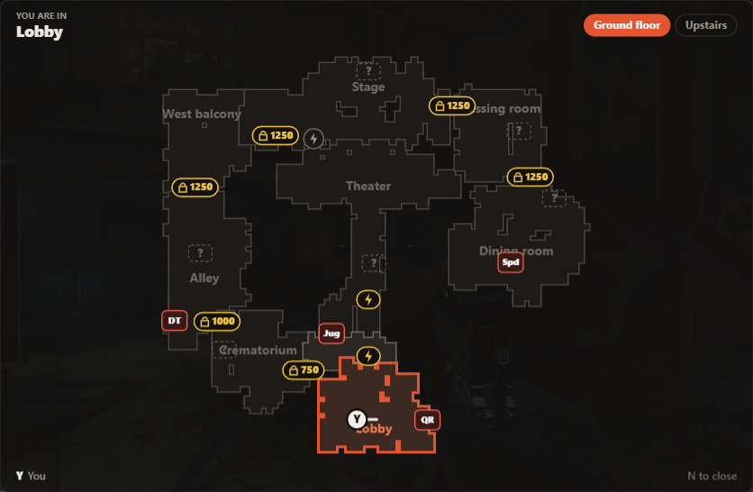
</p>

### From BO1 Zombies Co-op to this fork

[BO1 Zombies Co-op](https://github.com/AllanLotta/bo1-zombies-coop) by AllanLotta is the original extension this
project is built on: hosting, invite links, the lobby, controller support and Fun mode all come from there. **This fork
builds on it** and follows its updates, so new vel.gg engines keep working, and it adds:

|                  | Original BO1 Zombies Co-op                | This fork                                                                                     |
| :--------------- | :---------------------------------------- | :-------------------------------------------------------------------------------------------- |
| Map              | —                                         | **M** opens a map of the level; a minimap sits in the corner                                   |
| Weapons          | A fixed list of 24, the same on every map | Exactly the weapons the map has (Zap Guns on Moon, Thundergun on Kino, Baby Gun on Shangri-La…) |
| Perks & upgrades | —                                         | Any perk for free, Pack-a-Punch for the weapon in hand                                        |
| Health           | God mode only                             | Health levels from 100% to 500%, per player, on top of Juggernog                              |
| Give to          | The host only                             | You, one friend, or everyone at once                                                          |
| Rounds           | —                                         | Jump to any round (1–255), skip ahead, or freeze the round                                    |
| Connection       | Everything through a relay server         | Direct between players, with the relay as a fallback (or relay only, if you prefer)           |
| In-game menus    | Esc, which pauses the game for everyone   | **M** for the map and **N** for the cheat menu, without pausing anyone                        |

---

## 🚀 Get Started in 4 Steps

Everyone who plays installs the extension once: you and each friend. It takes about two minutes.

### Step 1: Download and unzip

Download [bo1-zombies-coop.zip](https://github.com/lucas-gundehug/bo1-zombies-coop/releases/latest/download/bo1-zombies-coop.zip)
and unzip it somewhere you'll keep it, for example `Documents\bo1-zombies-coop`. Chrome loads the extension from that
folder, so don't delete it afterwards.

### Step 2: Add it to Chrome

Open `chrome://extensions` (paste it in the address bar). If the original BO1 Zombies Co-op is installed, click
**Remove** on it first. Then:

**a.** Turn on **Developer mode** in the top right corner.

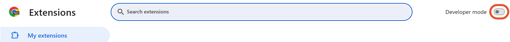

**b.** Click **Load unpacked** and pick the folder you unzipped (the one with `manifest.json` in it).

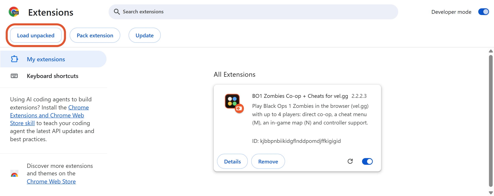

**c.** The extension shows up in the list. Keep its switch on.

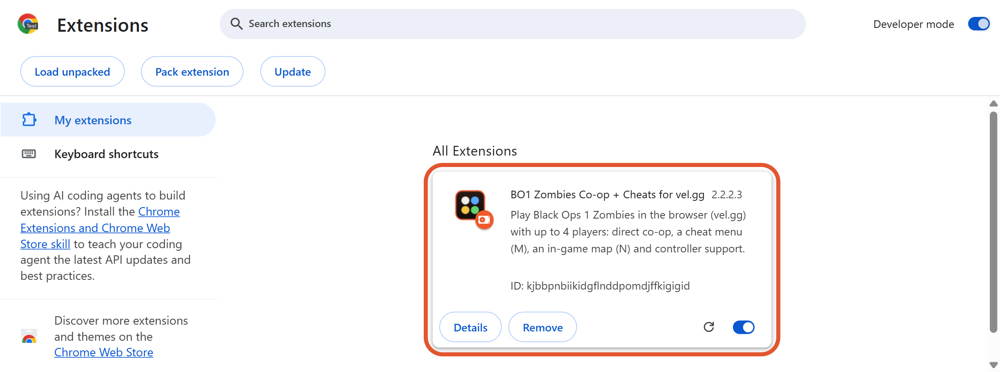

### Step 3: Host a game and invite your friends

Go to [vel.gg/bsz](https://vel.gg/bsz). The **Co-op** card shows up in the top right corner.

<table>
  <tr>
    <td width="33%" valign="top">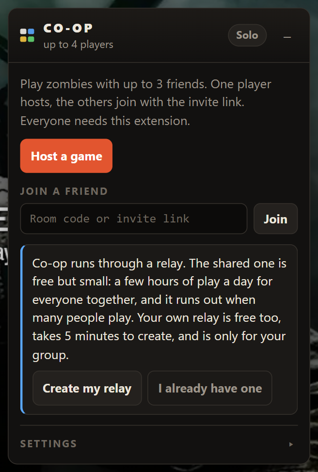</td>
    <td width="33%" valign="top">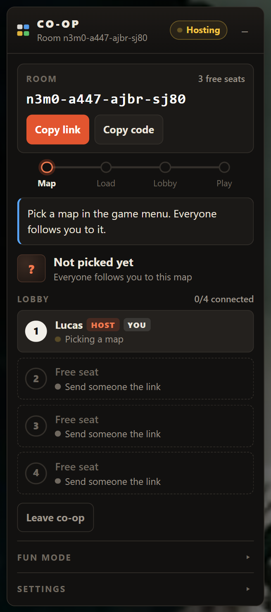</td>
    <td width="33%" valign="top">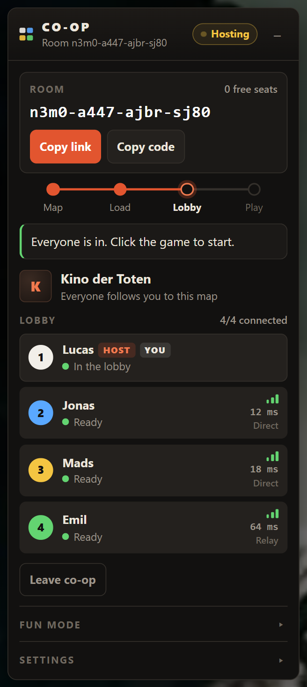</td>
  </tr>
  <tr>
    <td valign="top"><b>a.</b> Click <b>Host a game</b>.</td>
    <td valign="top"><b>b.</b> Click <b>Copy link</b> and send it to your friends. Pick a map in the game menu: everyone follows you to it.</td>
    <td valign="top"><b>c.</b> Your friends open the link and show up in the lobby. When everyone is in, click the game to start.</td>
  </tr>
</table>

To play alone, skip the hosting and just start a map: the maps and the cheat menu work solo too.

### Step 4: Play

| Key     | In a game                                                                                            |
| :------ | :--------------------------------------------------------------------------------------------------- |
| **M**   | Opens and closes the map. The minimap is always in the top left corner.                              |
| **N**   | Opens the cheat menu on the Co-op card. Click the game (or press N again) to go back.                |
| **Esc** | The game's own menu. It pauses the game for everyone.                                                |

Nothing pauses when you open the map or the cheat menu: you keep playing, and so do your friends.

**To update later:** download the new zip, unzip it over the old folder, and click the reload arrow on the extension
in `chrome://extensions`. The Co-op card tells you when a new version is out.

---

## 🎮 The Features

### 🗺️ The map (M)

Press **M** and a map of the level opens in the middle of the screen. You keep walking, aiming and shooting while it's
open. Press **M** again to close it.

<p align="center">
  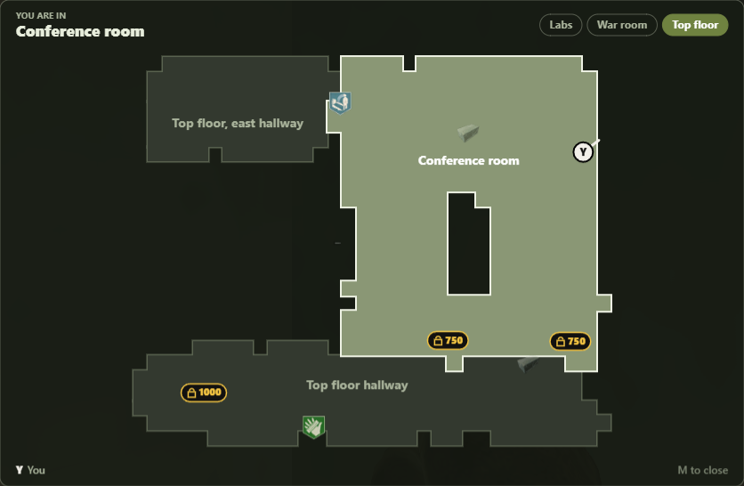
</p>

| On the map             | How it shows                                                                                             |
| :--------------------- | :------------------------------------------------------------------------------------------------------- |
| 🟠 **You and friends** | A dot in each player's colour with the first letter of their name, and a line for where they look. Dots glide smoothly; a downed friend gets a red ring. |
| 📍 **Your room**       | Outlined in orange, with its name at the top ("Lobby", "Theater"…).                                      |
| 🔒 **Closed doors**    | A lock with the price at every door and debris pile still closed; a lightning bolt for doors the power opens. Bought doors disappear. |
| 🥤 **Perks**           | Every perk machine, with the game's own perk icon.                                                      |
| 📦 **Mystery Box**     | Every spot the box can be, with the one it's in now ringed in gold.                                      |
| 🟣 **Pack-a-Punch**    | Where it is.                                                                                             |
| ⚡ **Power switch**    | Lit up once the power is on.                                                                             |
| 🏢 **Floors**          | On maps with several floors, the floor you're on, with buttons that show which friends are on another.   |

### 🧭 The minimap

A small map sits in the top left corner during every game. You stay in the middle and it scrolls under you as you run,
with the room you're in written on top. It shows the same rooms, doors, icons and friends as the big map, and hides
while the big map is open. Turn it off under **Settings → Minimap** on the Co-op card.

<p align="center">
  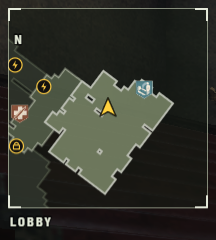
</p>

### 🔫 The cheat menu (N)

Press **N** in a game: the Co-op card opens at the cheat menu, without pausing. Pick who gets it under **Give to**,
then click. A message under the button tells you whether it worked.

<table>
  <tr>
    <td width="50%" valign="top">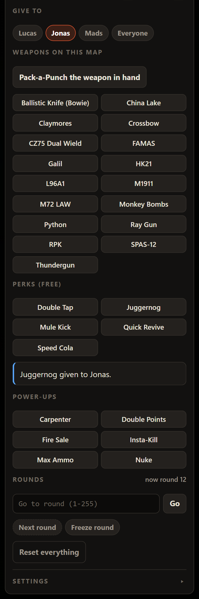</td>
    <td width="50%" valign="top">

| Section                  | What it does                                                                 |
| :----------------------- | :--------------------------------------------------------------------------- |
| **Give to**              | You, one friend, or everyone at once.                                        |
| **Weapons on this map**  | Only the weapons the map really has, wonder weapons included.               |
| **Pack-a-Punch**         | Upgrades the weapon the player is holding.                                   |
| **Perks (free)**         | The map's perk machines. The first perk turns the power on, as the switch would. |
| **Health**               | 100%, 150%, 200%, 300% or 500%. You still go down, just after more hits; Juggernog adds on top, and the level stays through revives and new rounds. |
| **Power-ups**            | Max Ammo, Insta-Kill, Nuke, Fire Sale and the rest, dropped in front of the player. |
| **Rounds**               | Jump to any round from 1 to 255, skip to the next one, or **Freeze round** so it doesn't end until you unfreeze it. |

Only the host needs this version for the cheat menu.

</td>
  </tr>
</table>

### 🕹️ Fun mode

Right above the cheat menu on the same card, from the original extension: per player **God mode**, **Can't die**,
**Invisible** (zombies ignore you), **Noclip**, **Fly**, speed and points, plus infinite ammo, zombie settings, game
speed, jump height and gravity.

<p align="center">
  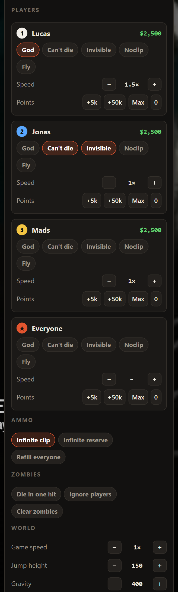
</p>

### ⚙️ Settings

The Co-op card's **Settings** hold your name, the controller, and the fork's switches:

<p align="center">
  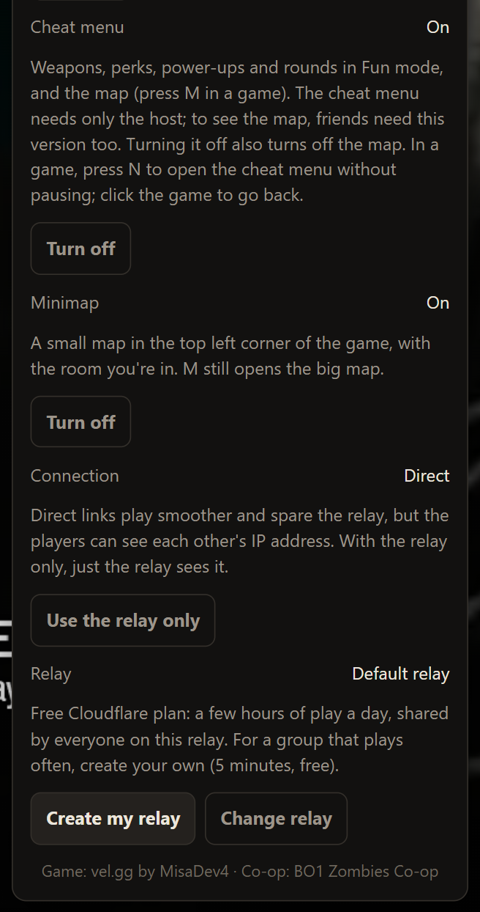
</p>

- **Cheat menu → Turn off** brings back the original Fun mode and turns off both maps (reload the page afterwards).
- **Minimap → Turn off** hides the corner minimap.
- **Connection → Use the relay only** never connects you directly to the other players (see below).
- **Relay** shows which relay you use, and lets you change it.

---

## 👥 Playing With Friends

**Direct by default.** When a friend joins your game, their browser connects straight to yours, and the game runs over
that direct link. There's nothing to set up. Two free public servers (from Cloudflare and Google) help the browsers
find each other. The Co-op card shows **Direct** or **Relay** under each player's ping.

**Rather not connect directly?** On a direct link the players can see each other's internet address (IP), as with any
direct game connection. Under **Settings → Connection**, click **Use the relay only** and reload the page: you then
never make a direct link, and your game goes through the relay. If the host chooses it, the whole game plays over the
relay; if a friend chooses it, only that friend does.

**The relay** is a small server that introduces players to each other. It also carries the game for anyone whose
direct link can't be made (or who chose the relay only), which happens on some strict home or work networks.
Everyone uses the original project's shared relay unless they pick their own.

**Your own relay (optional, free, 5 minutes).** The shared relay has a daily limit for everyone together. With direct
links it's rarely a problem, but if you play often, or friends keep showing **Relay**, make your own:

1. On the Co-op card's start screen, click **Create my relay**.
   [The guide](https://allanlotta.github.io/bo1-zombies-coop/#relay) walks you through it on a free Cloudflare
   account.
2. Open **Settings → Relay**, click **Change relay**, and paste your relay's address.
3. Host as usual. Your invite link carries your relay. Friends who open it see "This invite uses another relay" and
   click **Use this relay** once.

Only the host needs to set a relay up. Friends just open the invite link. Everyone who wants to see the maps needs this
version; friends on the original extension can still join and play, just without the maps.

---

## 🧩 Maps

All ten maps work with co-op, the cheat menu and the map: Nacht der Untoten, Verrückt, Shi No Numa, Der Riese, Kino der
Toten, "Five", Ascension, Call of the Dead, Shangri-La and Moon. Hell mode works too (it has no perk machines, and the
round controls are off there).

| Map                                    | Floors on the map                                   |
| :------------------------------------- | :-------------------------------------------------- |
| Kino der Toten                         | Ground floor, Upstairs                              |
| "Five"                                 | Top floor, War room, Labs                           |
| Moon                                   | No Man's Land, Moon base, Tunnels                   |
| Shangri-La                             | Temple, Caves                                       |
| Nacht, Verrückt, Shi No Numa           | Ground floor, Upstairs                              |
| Der Riese, Ascension, Call of the Dead | One floor (bridges and roofs drawn over the ground) |

When vel.gg updates its game, the card may say co-op is switched off until the extension is updated. A new download
appears on this page shortly after.

---

## 🏗️ How It Works

```
┌──────────────────────────────── Your browser ────────────────────────────────┐
│                                                                              │
│   Co-op card · cheat menu (N) · map (M)          vel.gg game engine          │
│   ┌─────────────────────────────┐   console   ┌───────────────────────────┐  │
│   │  Chrome extension           │◄───────────►│  Game script (a "mod")    │  │
│   │  src/cheats  src/map        │   dvars     │  weapons, perks, rounds,  │  │
│   │  src/session src/net        │             │  players, doors, rooms    │  │
│   └──────────────┬──────────────┘             └───────────────────────────┘  │
└──────────────────┼───────────────────────────────────────────────────────────┘
                   │ game packets + control messages (map, lobby, positions)
                   ▼
   ┌───────────────────────────────┐        ┌──────────────────────────────────┐
   │  Friends' browsers            │◄──────►│  Relay (Cloudflare Worker)       │
   │  direct WebRTC link per friend│        │  introduces players, fallback     │
   └───────────────────────────────┘        └──────────────────────────────────┘
```

- **The game script.** vel.gg's engine can load extra game scripts ("mods", see
  [MisaDev4/bo1-zombies-decompiled](https://github.com/MisaDev4/bo1-zombies-decompiled)). Right before a map starts,
  the extension puts a small script into the game's storage in the browser and switches it on. It uses the game's own
  functions to give weapons and perks, set health, Pack-a-Punch, drop power-ups and change rounds. It also reports what
  the map has, where every player is, and which doors and rooms are open.
- **The bridge.** The extension talks to the script through the game console: commands go in as console settings, and
  the answers come back as console prints.
- **The maps.** Floor plans for all ten maps are made once from the game's own path nodes and bundled with the
  extension. While playing, the host's game sends positions and door states a few times a second, and the extension
  draws them over the game. The perk and box icons are read from the game's own files in your browser.
- **Direct links.** Each friend connects straight to the host over WebRTC. The relay passes the introduction along and
  carries the game for anyone whose direct link can't be made.

Details for developers: [AGENTS.md](AGENTS.md).

---

## 🧪 Testing & Verification

| Command                                     | What it checks                                                                  |
| :------------------------------------------ | :------------------------------------------------------------------------------ |
| `npm run check`                             | Lint, build and the unit tests (cheat menu, map, engine patches, direct links). |
| `node test/cheats-e2e.mjs <map> <scenario>` | The real game in a browser: every cheat command, health levels, the maps (`map`, `map-script`), Hell mode with `HORDE=1`. |
| `node test/e2e.mjs <players> <map>`         | Real co-op with one browser per player, through a local relay (`npm run relay:dev`). `MAP=1` checks the friends' maps; `RELAYONLY=2` a friend on the relay only. |
| `node scripts/map-plan.mjs <map\|all>`      | Makes a map's floor plan again from the game (`rebuild` remakes them from the saved data). |

---

## 🙏 Credits

- [AllanLotta/bo1-zombies-coop](https://github.com/AllanLotta/bo1-zombies-coop): the co-op extension this is built on.
- [vel.gg](https://vel.gg/bsz) and [MisaDev4](https://github.com/MisaDev4/bo1-zombies-decompiled): the game in the
  browser and its mod system.
